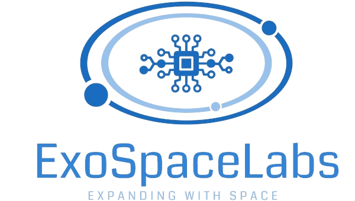

# ExoSpaceLabs



**Expanding with Space**

ExoSpaceLabs develops open-source engineering infrastructure for spacecraft communications, embedded avionics, real-time execution, simulation, FPGA integration, and mission observability. The portfolio emphasizes standards-based interfaces, explicit ownership boundaries, reproducible builds, representative hardware validation, and reusable contracts that can move from desktop simulation to embedded targets.

## Project Portfolio

| Project | Lifecycle | Current position |
| --- | --- | --- |
| **[CCSDSPack](https://github.com/ExoSpaceLabs/CCSDSPack)**<br> | **Stable / v2.1.0** | Layered CCSDS Space Packet library with an authoritative C11 protocol core and compatible C++17 API. v2.1.0 was published on 2026-10-25 after Raspberry Pi 5/native arm64 and NUCLEO-H755ZI-Q qualification. Development has moved to v2.2, where C11 is being made the single authority for protocol validation across remaining C++ boundaries. |
| **[HardRT](https://github.com/ExoSpaceLabs/hardrt)**<br> | **Stable / 0.6.0** | Static-allocation real-time kernel with bounded IPC timeouts, bounded transitive priority inheritance, and phase-preserving periodic timing. 0.6.0 was published on 2026-10-25 after full STM32H755 qualification. main and develop are currently aligned; the next major engineering phase is deeper timing/interference qualification toward the 1.0 hard-real-time contract. |
| **[SpWKit](https://github.com/ExoSpaceLabs/spwkit)**<br> | **Stable / v0.7.0 · active pre-v1 development** | Portable C11 SpaceWire development and integration toolkit with simulation, distributed transports, Linux virtual devices, and a public hardware-driver contract. Physical RAW-Ethernet functionality passes across PC, Raspberry Pi 5, and STM32H755. Current development is instrumenting and qualifying end-to-end transport performance, including ACK/retry and TX-slot diagnostics, before the v0.8 readiness freeze. |
| **[EXN](https://github.com/ExoSpaceLabs/exn)**<br> | **Active architecture / integration** | Modular satellite-avionics demonstrator and the single authority for EXN system architecture and component-to-component ICDs. Mission interfaces use CCSDS/PUS-C; the P0 path is Ground → Pi communications → STM32 OBC, while FPGA support remains modular. EXN owns interfaces between logical components even when they share one physical host; component-internal implementation contracts remain local to their repositories. |
| **[EXN-GS](https://github.com/ExoSpaceLabs/exn-gs)**<br> | **Active / PUS-C HIL baseline** | C++17 Ground/HIL environment with transport daemon, operator UI, CLI, STM32 simulator, Serial/TCP links, PUS-C packet handling, Service 1 verification, System HK support, and central-ICD-driven mission semantics. |
| **[WorldSat Monitor](https://github.com/ExoSpaceLabs/world-sat-monitor)**<br> | **Stable / v1.1.0 · active post-release development** | Self-hosted satellite and constellation situational-awareness platform with backend SGP4 propagation, provider resilience, source provenance, persistent state, and interactive 3D Earth visualization. Post-v1.1 work includes mobile/error-path UI qualification, browser/WebGL end-to-end validation, and a serverless ChatGPT Sites deployment path that does not replace the normal Docker Compose flow. |

## Current Engineering Position

The reusable foundations have moved from release preparation into active follow-on development:

```text
CCSDSPack
├── v2.1.0 released and hardware-qualified
└── v2.2 active
    └── C11 becomes sole protocol-validation authority at C++ boundaries

HardRT
├── 0.6.0 released and STM32H755-qualified
├── main == develop
└── next: 0.7 timing / interference / analytical qualification

SpWKit
├── v0.7.0 released
├── physical PC ↔ Pi ↔ STM32 functionality PASS
└── transport performance qualification active
    ├── ACK/retry investigation
    └── CPU / TX-slot / carrier-frame diagnostics

EXN
├── central PUS-C component-to-component ICD defined
├── P0 Ground ↔ Pi communications ↔ STM32 OBC
├── FPGA deployment optional
└── component implementation + end-to-end HIL remain the main system work

WorldSat Monitor
├── v1.1.0 baseline
├── post-v1.1 UI resilience/mobile validation on develop
├── browser/WebGL E2E qualification open
└── serverless Sites deployment PR active
```

## Engineering Focus

- **Space communications:** CCSDS Space Packets, ECSS PUS-C, SpaceWire transport, protocol validation, routing, and interoperability contracts.
- **Embedded and real-time systems:** STM32/Cortex-M software, deterministic scheduling, bounded synchronization, DMA/cache ownership, and hardware qualification.
- **FPGA and hardware integration:** project-owned RTL and implementation-specific hardware kept behind reusable software-facing provider contracts.
- **Simulation and HIL:** host simulation, virtual/distributed links, device emulation, fault injection, and staged physical integration.
- **Standards and assurance:** scoped ECSS conformance, requirements-to-test traceability, compatibility discipline, and reproducible qualification evidence.
- **Performance characterization:** measurement before optimization, with software, provider/controller, and physical-link effects kept distinct.
- **Mission observability:** satellite tracking, propagation, provider/source health, state persistence, and operational visualization.
- **Release engineering:** version-driven publication, multi-platform CI, external-consumer validation, hardware evidence, and deterministic regeneration of qualification diagnostics.

Detailed lifecycle and development state is maintained in **[Project Status](../docs/PROJECTSTATUS.md)**.

## Engineering Principles

Projects are expected to have a defined scope, documented interfaces, automated validation, explicit versioning/compatibility policy, and a credible route to representative hardware. EXN owns mission-visible component interfaces; implementation-internal contracts remain with the component that owns them. Public APIs should expose implementation-independent contracts, and claims should follow evidence.

## Contributing

Issues and pull requests are welcome where a repository is open for contribution. Use each repository's documentation and issue tracker for project-specific requirements, compatibility constraints, and current priorities.

## Contact

- **GitHub:** [ExoSpaceLabs](https://github.com/ExoSpaceLabs)
- **Discussions:** [GitHub Discussions](https://github.com/orgs/ExoSpaceLabs/discussions)
- **Email:** exospacelabs@gmail.com

Repository-level license files are authoritative for each project.
